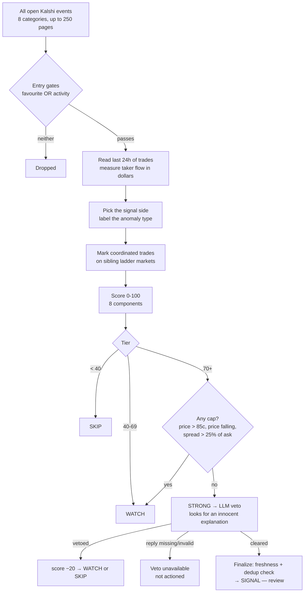

# Anomaly detection — how it works

This document explains how the `k-anomaly` pipeline decides which markets to flag,
step by step, and why each rule exists. It describes the code as of commit `2f1d374`
(2026-11-17).

## The idea in one paragraph

The regular pipeline looks for markets where the outcome is almost certain and the price
has not caught up. The anomaly pipeline looks for something different: markets where
**someone is spending real money on one side, fast, before the price has fully moved**.
That pattern can mean a trader knows something the market does not yet price in. The
pipeline does not estimate who will win. It measures how unusual the buying is, filters
out buying that has an innocent explanation, and hands the survivors to a human as
**signals to review**, not as priced bets.

## The pipeline at a glance



| Stage | Code | Output |
|---|---|---|
| 1. Scan | `step_1_scan/anomaly_scanner.py` | `anomaly_candidates.json` |
| 2. Score | `step_3_classification/anomaly_scorer.py` (called by `classify_all.py`) | `classified.json` with tier + breakdown |
| 3. Veto | `step_3_classification/classifier.py` (API) or `anomaly_veto.py` (in-context) | veto fields on STRONG rows |
| 4. Verify | `step_4_verify/verify_classifications.py` | **Skips anomalies** — it only checks CERTAIN rows |
| 5. Finalize | `step_5_finalize/opportunity_manager.py`, `excel_reporter.py` | Excel report, dashboard log |

All thresholds live in `ANOMALY_DEFAULTS` in `shared/config.py` (scanner) and as
constants at the top of `anomaly_scorer.py` (scorer).

---

## Key terms

- **YES / NO side.** Every Kalshi contract pays $1 if its side wins. A YES at 22c and a NO
  at 78c are the two halves of the same market.
- **Price side.** The side the market currently favours (the higher bid). Before trades are
  read, this is the default side.
- **Taker.** The trader who crosses the spread to trade immediately. Paying the spread is a
  sign of urgency. Kalshi records which side each taker bought (`taker_side`).
- **Taker flow.** The total money takers spent buying YES versus buying NO in the last
  24 hours. This is the only thing in the system that shows **direction**.
- **Signal side.** The side the taker money backs. It can differ from the price side.
- **Ladder market.** An event split into "above X" or "below X" strikes (e.g. *Rotten
  Tomatoes score above 50 / 55 / 60 / 75*). Kalshi marks these with `strike_type`
  `greater` or `less`.

**Taker vs. maker (and why it isn't buyer vs. seller).** Every trade has two sides
described in two separate ways: a buyer and a seller (the direction), and a maker and a
taker (who waited and who acted). A **maker** leaves an order on the book, like "buy YES
at 40c", and waits for someone to accept it. A **taker** fills an order that is already
there, at the price that is already posted. If the best bid is 40c and the best ask is 44c,
a patient trader can bid 41c and hope to be filled. An impatient trader buys at 44c right
away. That trader is the taker, and they paid about 3c extra for speed. A taker can be on
either side. On Kalshi, buying YES at 44c is the same as selling NO at 56c, so the trade
feed doesn't say "buyer" or "seller". It records `taker_side` (`yes` or `no`), which is the
outcome the impatient trader backed. Volume alone shows no direction, because every
contract traded has a YES holder and a NO holder. Taker side does show direction. If $45k of
a $50k hour came from takers paying up for YES, someone was in a hurry to own YES. An even
split between YES and NO takers is just ordinary two-way trading.

---

## Stage 1 — Scanning

The scanner pages through every open event on Kalshi (`/events`, 100 per page, up to 250
pages) and keeps markets in these categories: Politics, Economics, Entertainment, Weather,
World, Elections, Health, Finance.

### Basic exclusions

A market is dropped immediately if:

- it is a multi-leg combo market (ticker contains `COMBO`; or, for markets without a series
  ticker, the title or subtitle lists more than two `,yes` / `,no` legs), or
- it closes in the past or more than 365 days from now.

### The two entry gates

**What a gate is.** Kalshi has thousands of open markets, and most of them are quiet.
Reading the trade history of every one would be slow and expensive. So before the scanner
looks at any trades, it runs each market through two cheap checks that use only the
numbers already in the market listing: price, spread, lifetime volume and 24h volume.
These checks are the "entry gates". A market that fails both is dropped on the spot. A
market that passes either one goes on to the expensive step, which is reading its
trades and measuring taker flow.

**"Favourite OR activity".** The two gates look for two different kinds of interesting
market, and a market only needs to pass one of them:

- The **favourite gate** asks: *is this a market where one side is clearly favoured and a
  lot of money has traded?* For example, "Will the Fed hold rates?" with YES at 72c and
  $40k traded over its life passes. This gate looks at the market's whole history. It
  doesn't care whether anything happened today.
- The **activity gate** asks: *did trading suddenly jump in the last 24 hours?* For
  example, a sleepy market that normally trades 200 contracts a day and traded 5,000
  today passes, even if YES is only 8c. This gate doesn't care which side is favoured.
  It only cares that today is unusual.

"OR" means either reason is enough to take a closer look. A market can pass both (see
the worked example below, which passes both). The gates only decide whether the scanner
*looks*. They don't decide whether the market is an anomaly. That comes later, from
taker flow and the score.

A market moves on if it passes **either** gate. The candidate records which gate(s) it
passed in `gates`.

**Favourite gate** — "a lot of money sits on the favoured side."

| Check | Default |
|---|---|
| Price-side bid between | 20c and 79c |
| Lifetime volume at least | 500 contracts |
| Price-side spread at most | 10c |
| Lifetime "implied dollars" on the price side (`volume × price`) at least | $10,000 |
| Implied dollars ratio, price side ÷ other side, at least | 1.5 |

In practice the ratio check means the price side must be at least 60c, because
`volume × p ÷ volume × (100 − p)` is just `p ÷ (100 − p)`, and that reaches 1.5 at 60c.
So this gate admits favourites priced 60–79c with at least $10k of lifetime trading.

**Activity gate** — "a sudden burst of trading, at almost any price."

| Check | Default |
|---|---|
| YES bid between | 3c and 97c |
| Last-24h volume at least | 2,000 contracts |
| Spread at most 10c on | at least one side |
| 24h volume ÷ normal daily volume (the **spike**) at least | 3× |
| If the market is under 2 days old (no baseline) | needs 6,000 contracts in 24h instead |

"Normal daily volume" is `(lifetime volume − last 24h volume) ÷ (age in days − 1)`.

**Why two gates.** The original scanner only had the favourite gate. It can only ever see
buying of the side that is already favoured, in a narrow price band. It is blind to the
case that matters most for informed trading: someone quietly buying the *cheap* side
before news breaks. The activity gate catches any fresh burst at any price, on either side.

### Snapshot cache

Each scan writes every market's bid, volume and open interest to `anomaly_cache.json`.
The next scan compares against it (if the snapshot is under 168 hours old) to get
`oi_delta` — whether open interest grew. Growing open interest means new positions are
being opened, not just old ones changing hands.

### Reading the trades

For every market that passed a gate, the scanner reads the last 24 hours of trades
(`/markets/trades`, up to 5 pages of 1,000). To bound API cost, only the 600 markets with
the most 24h volume get this; the rest are scored without flow (and therefore score low).

From the trades it computes, **in dollars** (contracts × price paid):

| Field | Meaning |
|---|---|
| `taker_yes_dollars`, `taker_no_dollars` | Money takers spent buying each side |
| `flow_side`, `flow_share` | The side with more money, and its share of all taker money |
| `top5_share` | Share of the money in the 5 biggest trades |
| `large_trades` | Individual trades of $500 or more (top 20 kept) |
| `contract_side`, `contract_share` | The same, counted in contracts — kept for comparison only |

**Why dollars, not contracts.** A 3c contract and a 70c contract are very different bets.
Buying 10,000 contracts at 3c costs $300; buying 10,000 at 70c costs $7,000. Counting
contracts made cheap longshots look heavily bought when little money was actually spent.
In run `20261116_2000` (before the fix), 50 of 307 candidates had the contract majority on
one side and the dollar majority on the other, and 5 of its 29 STRONG signals pointed the
wrong way. After the switch, `longshot_accumulation` labels fell from 103 to 11 (run
`20261116_2259`).

### Choosing the signal side and type

| Condition | Signal side | `anomaly_type` |
|---|---|---|
| Leading side has at least **$2,000** of taker money, and it is the price side | price side | `favourite_accumulation` |
| Same, but it is the cheaper side | the cheaper side | `longshot_accumulation` |
| Less than $2,000 on the leading side, or trades could not be read | price side | `volume_only` |

Once the side is known, every side-specific field is recomputed for it: its bid
(`hc_price`), ask, spread, the dollars spent on it, and its price change over 24 hours
(`signal_price_change_24h`, from Kalshi's last vs previous price, flipped for NO).

**Why a $2,000 floor.** Before it existed, markets reached STRONG on $390–$1,500 of
signal-side money — sometimes four trades. That is too little to call a confident view.

### Coordinated trades across sibling markets

After all candidates have flow, the scanner checks each event's sibling markets. A
candidate gets `cotimed_markets` filled when, within **15 minutes**, a large trade on its
signal side lines up with a large trade on the same side of a sibling market, **and** both
markets are rungs of the same ladder (`greater` or `less`) **and** both have the same
signal side.

Example: large YES buys on "Rotten Tomatoes above 60" and "above 75" a few minutes apart
both express one view — the score will be high. That counts.

**Why only ladders, only same side.** The first version counted any large trades on any
siblings. That treated buying several *named* outcomes at once (Person of the Year
candidates, rate-decision buckets) as coordination, when it is really spreading bets or
hedging. Kalshi's own `mutually_exclusive` flag could not be used to tell these apart:
it is unreliable (`KXTIME-26`, a pick-one-person market, reports `False`).

---

## Stage 2 — Scoring

`score_anomaly()` picks a model:

- **Flow model** — any candidate whose evidence contains trade flow (all Kalshi candidates).
- **Legacy model** — candidates without trade flow (Polymarket `pm-anomaly`). It scores
  lifetime implied dollars, open-interest ratios and snapshot deltas, with STRONG at 70 and
  WATCH at 45. The rest of this section is about the flow model.

### Flow-model components

The score is the sum of eight parts, clamped to 0–100.

| # | Component | What it measures | Points |
|---|---|---|---|
| 1 | `flow_imbalance` | Share of 24h taker money on the signal side. Only counts if the signal side has ≥ $2,000. | ≥85% → 30 · ≥75% → 22 · ≥65% → 14 · ≥58% → 6 |
| 2 | `volume_spike` | 24h volume ÷ normal daily volume | ≥50× → 20 · ≥20× → 15 · ≥10× → 10 · ≥5× → 6 · ≥3× → 3 · new market → 5 |
| 3 | `recent_size` | Dollars taken on the signal side in 24h | ≥$50k → 15 · ≥$20k → 12 · ≥$10k → 9 · ≥$5k → 5 · ≥$2k → 2 |
| 4 | `price_response` | Signal side's price move over 24h, in cents | ≥+25 → 5 (already repriced) · ≥+5 → 15 · ≥+2 → 10 · above −3 → 6 · −3 or worse → 0 and capped · no price history → 0 |
| 5 | `coordination` | Same-side large trades on sibling ladder markets; otherwise any large trade on the signal side | cotimed → 10 · one large trade → 5 |
| 6 | `oi_growth` | Open interest rose since the last snapshot | 5 |
| 7 | `urgency` | Days to close | <7 → 5 · <30 → 4 · <90 → 2 |
| 8 | `concentration_penalty` | Share of the money in the 5 biggest trades | ≥90% → −15 · ≥80% → −8 |

**Why each part exists:**

1. **Flow imbalance** is the direction signal. Balanced buying on both sides is normal
   trading; lopsided buying means someone wants one side.
2. **Volume spike** says the buying is unusual *for this market*. 5,000 contracts a day is
   nothing for a Fed market and enormous for a film-score market. The bands were raised on
   2026-11-17 because most bursts were already 10× or more, so 10× no longer earns full points.
3. **Recent size** rewards real money. $50k is a serious view; $2k is a hint.
4. **Price response** reads the market's reaction. A modest rise means the market is
   starting to agree. A flat price means the buying is being absorbed — possibly someone
   getting in before the move. A huge move (≥25c) means the news is already priced and
   there is little left to catch, so it scores low. A *falling* price while takers buy
   means sellers are winning the argument; that is not a signal.
5. **Coordination** — the same view placed across several related markets within minutes
   looks like one informed actor, not random traders.
6. **Open-interest growth** separates new positions from old positions changing hands.
7. **Urgency** — informed money matters most close to the event.
8. **Concentration penalty** — if five trades carry 90% of the money, the "crowd" is one
   person. That person may be informed, or may simply be wrong. Before 2026-11-17 this
   was only a text note and did not affect the score.

### Tiers

| Score | Tier | Meaning |
|---|---|---|
| 70+ | **STRONG** | Candidate for review — goes to the veto |
| 40–69 | **WATCH** | Shown in the report, never actioned |
| below 40 | **SKIP** | Logged only |

STRONG is designed to be reachable on a **first sighting**: a clear one-sided burst
(30) + big spike (15–20) + price starting to follow (15) + a large trade (5) is already 65–70
without any snapshot history.

### Caps — STRONG that is demoted to WATCH

A candidate that scores 70+ is still capped at WATCH if any of these hold. The score is
kept; the reason is added to `score_flags` with "capped at WATCH".

| Cap | Why |
|---|---|
| Signal side bid above **85c** | Little upside left, and buying near 90c+ is mostly people closing positions, not new views. |
| Signal side price fell **3c or more** in 24h while being bought | The buyers are losing to sellers; the market disagrees with them. |
| Spread above **25% of the ask** | Getting in costs too much. The old fixed 10c limit let a 9c spread on a 15c contract (60%) pass. |

In run `20261116_2259`, 10 candidates scored 70+ but were capped. All 10 hit the 85c rule
(Fed December decision NO at 95c, GTA VI NO at 95c, and so on); one also hit the
falling-price rule.

### Flags

`score_flags` also carries notes that do not change the tier: "flow unreadable", "new
market", "already repriced", "concentrated", "trade history truncated". They appear in the
report's **Signal Warnings** column.

---

## Stage 3 — The veto

Only STRONG candidates go to the veto. WATCH and SKIP are not checked, because the veto
can only lower a tier and neither of those is actionable anyway.

### What the veto is for

The score is pure market data. It cannot know that, for example, the event already
happened, or that the buying is a hedge around a scheduled announcement. The veto is an
LLM with web search whose **only** job is to find a clear public reason the buying is
**not** a directional bet. It is a noise filter, not a second opinion on who will win.

It may veto (`vetoed=true`, confidence 70–100) only for:

1. The event has already been decided against the signal side.
2. Hedging — the buying offsets a related position or brackets a scheduled event.
3. Market-making or arbitrage — balanced two-sided activity or mechanical rebalancing
   across sibling strikes.
4. A settlement technicality means the signal side cannot win.
5. Strong, specific, recent public evidence that the signal side will lose — an official
   announcement, published data, or confirmed date. Opinions and forecasts do not count.

It must **not** veto because news *supports* the signal side (that means the price may be
lagging — a stronger signal), nor for general uncertainty, nor because the price is low.

**Why rule 5 was added.** On 2026-11-16, the GTA VI "released on time" market flagged
buying of NO at 3c — a bet on a delay. It cleared the veto even though the publisher had
just reaffirmed the launch date. Rules 1–4 did not cover
"concrete public evidence says this side loses", so an obviously contradicted signal was
passed through.

### Two ways to run it

| Mode | When | How |
|---|---|---|
| **API** | `classify_all.py --model X` | The classifier calls model X once per STRONG candidate, with one retry on a malformed reply. |
| **In-context** (default) | no `--model` | `classify_all.py` marks STRONG rows `veto_pending`. Then `anomaly_veto.py plan` splits them into pairs; one subagent per pair runs `anomaly_veto.py prompt` for each ticker, does at least 2 web searches, and writes a JSON reply with `_model_provenance`. `anomaly_veto.py apply` reads the replies. |

The in-context route follows the project rule of at most 2 candidates per subagent, so
each candidate gets a focused look and is never judged by comparison with another.

### Outcomes

| Result | Effect |
|---|---|
| Cleared (`vetoed=false`) | Stays STRONG and becomes actionable. |
| Vetoed | Score −20, tier drops to WATCH (or SKIP if below 40). Reason goes to Contradicting Signals. |
| Reply missing or invalid | `veto_unavailable`: stays labelled STRONG but **not actionable** — "review manually". |
| Still pending (veto never run) | Not actionable. |

**Why "unavailable" is never a pass.** If the check could not run, the system does not
know whether the buying is noise. Treating silence as approval would let every STRONG
through whenever the veto breaks.

Evidence the veto found *against* the signal side that is not strong enough to veto is kept
in `veto_reason` with `vetoed=false`, and shown in the report as "Against (not vetoed)".
Evidence *for* the signal side goes in `supporting_info`, shown as "For: …".

---

## Stage 4 — Verify

`verify_classifications.py` only checks CERTAIN classifications from the regular
pipeline. Anomaly rows pass through unchanged; their quality control is the scorer's caps
and the veto.

---

## Stage 5 — Finalize and report

`OpportunityManager.process()` routes every row:

| Row | Routing |
|---|---|
| WATCH or SKIP | `skipped_not_certain` (logged; listed on the report's All Results sheet) |
| STRONG, veto pending / unavailable | `skipped_validation_failed` |
| STRONG, cleared, market now closed | `skipped_market_closed` (quotes older than 5 minutes are refreshed first) |
| STRONG, cleared, fresh quote could not be fetched or is unusable | `skipped_market_unconfirmed` |
| STRONG, cleared, already notified for this ticker + side in the last 7 days | `skipped_already_notified` |
| STRONG, cleared, otherwise | **`notify_signal`** — report Status **"SIGNAL — review"** |

Signals are listed after any priced opportunities, strongest score first.

### Why anomalies have no edge or position size

The regular pipeline computes edge as "our probability − market price". Anomaly rows
originally fed their **signal score** into that formula as if it were a probability. A
score of 85 means "this buying is very unusual", not "85% chance to win". The result was
nonsense: a Fed YES at 5c showed a 1,595% edge, GTA VI showed 2,265%. Position size used a
different formula (bid + 20c) and disagreed with the edge. Since 2026-11-17, anomalies get
no edge and no size; the report and dashboard say "not calculated by design".

### Report columns specific to anomalies

| Column | Content |
|---|---|
| Classification | STRONG / WATCH / SKIP |
| Signal Score | 0–100 (Confidence % is left blank — there is no probability) |
| Anomaly Evidence | e.g. "buying the longshot \| 24h: $3,974 bought YES vs $688 NO (85%) \| 43 trades, top 5 = 76% of $ \| volume 97x normal \| YES price +6c in 24h \| same-side big trades on: …" |
| Signal Warnings | `score_flags`, including caps |
| Veto Notes | pending / unavailable / VETOED (confidence) / Against (not vetoed), plus "For: …" supporting evidence |

---

## Worked example — `KXRT-VIO-75`

From run `20261116_2259_k-anomaly`. Market: **"Violent Night 2 Rotten Tomatoes score?
Above 75"**, 20 days to close. YES 22c bid / 23c ask, NO 77c bid / 78c ask.

**1. Gates.** The price side is NO at 77c.

- *Favourite gate:* 77c is in 20–79c; lifetime volume 27,335 × 0.77 = $21,048 ≥ $10k;
  ratio 77 ÷ 23 = 3.35 ≥ 1.5. **Pass.**
- *Activity gate:* YES 22c is in 3–97c; 24h volume 21,320 ≥ 2,000; normal daily volume
  before that was ~219, so the spike is **97×** ≥ 3×. **Pass.**

**2. Taker flow (24h, 43 trades).**

| | Contracts | Dollars |
|---|---|---|
| Takers bought YES | 20,383 (96%) | $3,974 (85%) |
| Takers bought NO | 937 | $688 |

YES leads with $3,974 ≥ $2,000, and YES is the cheaper side, so the signal side becomes
**YES at 22c** and the type is **`longshot_accumulation`**. Note how counting contracts
would have overstated it: 96% of contracts but only 85% of the money.

**3. Coordination.** Large YES trades on this market and on its siblings "Above 50 / 55 /
60 / 65" landed within 15 minutes of each other. All are `greater` ladder rungs with YES as
the signal side — one consistent view that the film will review well.

**4. Score.**

| Component | Input | Points |
|---|---|---|
| flow_imbalance | 85.3% of money on YES | 30 |
| volume_spike | 97× | 20 |
| recent_size | $3,974 | 2 |
| price_response | YES +6c in 24h | 15 |
| coordination | 4 sibling ladder markets | 10 |
| oi_growth | open interest −7 since last snapshot | 0 |
| urgency | 20 days | 4 |
| concentration_penalty | top 5 trades = 76% (< 80%) | 0 |
| **Total** | | **81 → STRONG** |

**5. Caps.** YES at 22c is below 85c; price rose, not fell; spread is 1c on a 23c ask (4%).
No cap applies.

**6. Veto (in-context, Opus 5.5).** Cleared:

> *veto_reason:* No veto basis found: film opens Dec 4, 2026 with no reviews or Tomatometer
> yet. Flow is 85% YES, not balanced market-making. There is no concrete public evidence
> the score will be at or below 75; a sequel-dropoff risk is only speculation.
>
> *supporting_info:* The 2022 original sits at 74% (some reports say 70%), right at this
> strike. Director Wirkola and David Harbour return, and Kristen Bell joins. Trailer
> coverage praised the action and tone.

**7. Finalize.** Valid STRONG, so it would be reported as **SIGNAL — review** with no edge
or size. In this particular run it was routed `skipped_already_notified` instead: the
earlier 2026-11-16 run had already notified `KXRT-VIO-75:YES`, and the same ticker + side is
not re-notified for 7 days.

**How to read it.** The strength here comes from *pattern*, not size: a 97× burst, nearly
one-directional, across a whole ladder, with the price starting to follow. The weak part is
money — under $4k on the signal side earned only 2 of 15 size points. A reviewer should
weigh exactly that: a coordinated, consistent view, held by someone who did not bet much.

### Contrast — capped candidates in the same run

| Ticker | Score | Why not STRONG |
|---|---|---|
| `KXRT-HUN-55` | 85 | YES already at 95c (> 85c) |
| `KXFEDDECISION-26DEC-H0` | 72 | NO already at 95c |
| `KXRT-HUN-60` | 74 | YES at 89c; price fell 7c while being bought; top 5 trades = 86% of money (−8) |

## Run statistics

| Run | Rules | Candidates | STRONG |
|---|---|---|---|
| 2026-11-16 20:00 | before dollar-flow fixes | 307 | 29 — 142 SKIP, 136 WATCH |
| 2026-11-16 22:59 | current | 309 | 9 (all cleared the veto) — 228 SKIP, 72 WATCH |

Of the 309 current candidates: 213 `volume_only`, 85 `favourite_accumulation`,
11 `longshot_accumulation`.

## Commands

```sh
python3 pythia-main k-anomaly                                   # scan + print next steps
python3 step_3_classification/classify_all.py --run-dir RUN     # score (+ API veto with --model)
python3 step_3_classification/anomaly_veto.py plan  --run-dir RUN
python3 step_3_classification/anomaly_veto.py prompt --run-dir RUN --ticker T
python3 step_3_classification/anomaly_veto.py apply --run-dir RUN
python3 step_4_verify/verify_classifications.py
python3 pythia-main finalize
python3 -m unittest tests.test_anomaly_flow
```
